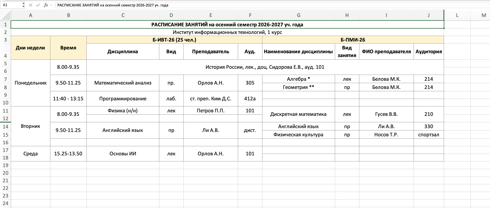
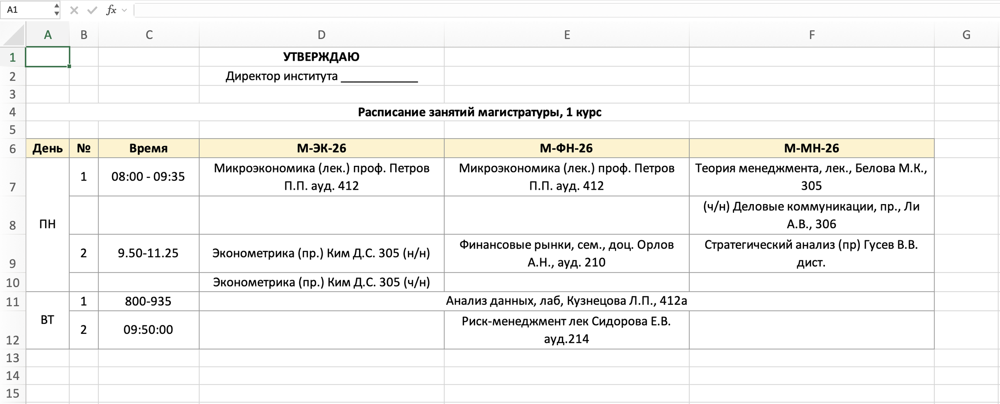
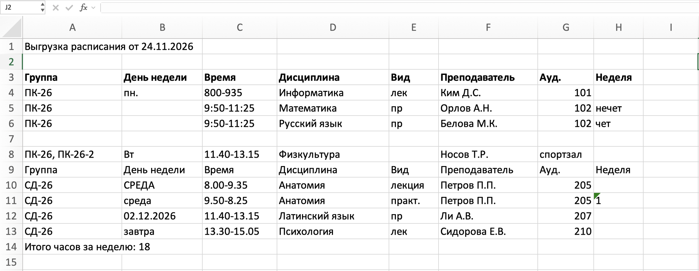
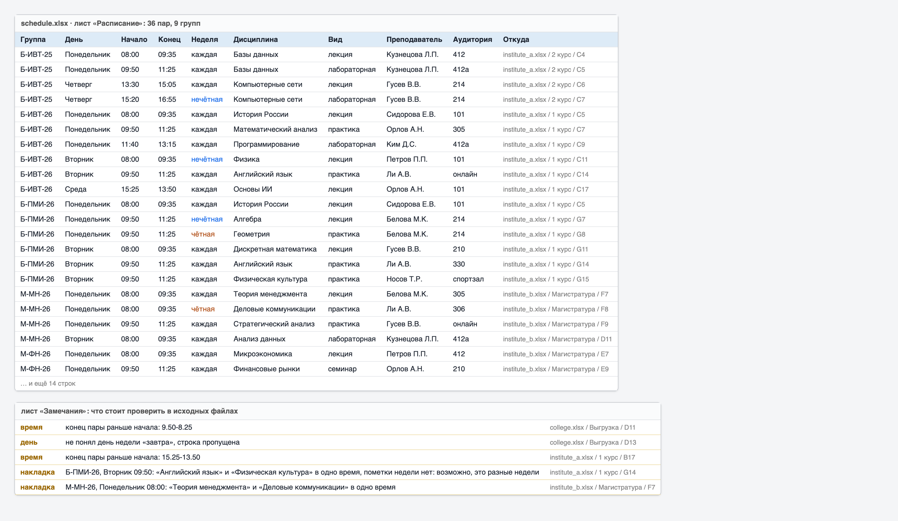

# excel-schedule-normalizer

Сводит расписания из Excel-файлов разного вида в одну чистую таблицу: группа, день, время, неделя, дисциплина, вид занятия, преподаватель, аудитория. Всё, что не удалось понять однозначно, попадает в отдельный список замечаний со ссылкой на ячейку.

Это демонстрационная версия подхода из моего рабочего проекта (о нём ниже). Данные в примерах выдуманы. Бот, который показывает такое расписание студентам: [telegram-bot-showcase](https://github.com/YaNTCN/telegram-bot-showcase).

**До:** три файла, у каждого свой формат.

Сетка с подписанными столбцами: поток на две группы, недели звёздочками, объединённые ячейки, опечатка во времени.



Вся пара записана текстом в одной ячейке, время только в первой строке пары.



Выгрузка списком: повтор шапки, пустые строки, итоги, разнобой в днях недели.



**После:** одна таблица и список замечаний.



## Кейс: расписание университета в Telegram-боте

**Задача.** Студентам нужен бот ([@paralar_bot](https://t.me/paralar_bot)), который показывает расписание их группы на сегодня, на завтра и на неделю. Источник данных: Excel-файлы, которые институты выкладывают на сайт вуза.

**Сложность.** Больше 20 институтов и колледжей, и каждый ведёт таблицу по-своему:

- группы в столбцах или списком по строкам, у одних по 4 подписанных столбца на группу, у других вся пара записана текстом в одной ячейке;
- объединённые ячейки: поток на несколько групп, одна пара на две недели, день недели на десяток строк;
- неделя отмечается то звёздочками, то «ч/н» и «н/н», то отдельной строкой без пометки;
- время пишут как угодно: «8.00-9.35», «08:00 – 09:35», «800-935», ячейкой времени Excel;
- скрытые листы и строки с черновиками, повторы шапки, итоги, опечатки (конец пары раньше начала);
- кроме xlsx: старые xls, PDF, выгрузки с Яндекс Диска, листы на каждый день;
- файлы меняются в течение семестра без предупреждения.

**Решение.** Парсер не привязан к координатам ячеек. Он сам находит на листе строку с группами, столбцы дней и времени, роли столбцов по подписям или по содержимому и раскладку таблицы. Каждая пара помнит, из какой ячейки она взята. Все сомнительные места не угадываются молча, а попадают в отчёт. Отдельно работают:

- слежение за сайтом: скачиваются только изменившиеся файлы;
- карантин: если в новом файле резко пропали пары, он не публикуется, пока не подтвердится;
- независимая сверка: второй разборщик по своим правилам читает те же файлы и сравнивает результат;
- эталонные файлы в тестах: любое изменение кода проверяется на реальных таблицах всех институтов.

**Результат.**

- 791 группа из 22 источников в одном формате, бот обновляет данные сам;
- полная сверка всех групп с исходными файлами один к одному;
- около 580 автотестов у парсера;
- каждый новый институт подключается за часы, а не за дни: чаще всего хватает настроек, без нового кода.

Боевой код закрыт. По запросу могу показать его на созвоне.

## Что умеет эта версия

| Что в файле | Что получится |
|---|---|
| Группы в столбцах, у каждой подписи «Дисциплина / Вид / Преподаватель / Ауд.» в любом порядке | Поля разложены по столбцам |
| Пара текстом в одной ячейке: «Микроэкономика (лек.) проф. Петров П.П. ауд. 412» | Дисциплина, вид, преподаватель без должности, аудитория |
| Объединённая ячейка на несколько групп (поток) | Пара у каждой группы |
| Объединённая ячейка на две строки одной пары | Одна пара на обе недели |
| «*», «**», «н/н», «ч/н», столбец «Неделя» со значениями «нечет», «1», «II» | Нечётная / чётная / каждая |
| «8.00-9.35», «с 8:00 до 9:35», «800-935», ячейка времени Excel | Начало и конец в формате ЧЧ:ММ |
| Время только в первой строке пары | Вторая строка получает то же время |
| «Пн», «пн.», «ПОНЕДЕЛЬНИК», дата «02.12.2026» | День недели |
| «Б-ИВТ-26 (25 чел.)», «ПК-26, ПК-26-2» | Названия групп, несколько групп в одной строке |
| «дист.», «онлайн», «zoom» | Аудитория «онлайн» |
| Список из учётной системы: повтор шапки, пустые строки, итоги, день только в первой строке | Пропускается мусор, день подставляется |
| Скрытые листы, строки и столбцы | Не читаются |

Замечания, которые попадают в отчёт:

- конец пары раньше начала;
- непонятный день недели («завтра»);
- две разные пары у группы в одно время одной недели (в том числе две строки одной пары без пометки недели);
- лист, на котором не нашлось расписания.

## Запуск

Нужен Python 3.10 или новее.

```bash
pip install -e .
schedule-normalizer examples/input/*.xlsx -o schedule.xlsx
```

```
Файлов: 3, листов: 4, групп: 9, пар: 36, замечаний: 5
  [время] конец пары раньше начала: 9.50-8.25  (college.xlsx / Выгрузка / D11)
  [день] не понял день недели «завтра», строка пропущена  (college.xlsx / Выгрузка / D13)
  ...
Сохранено: schedule.xlsx
```

Формат выбирается по расширению: `.xlsx` (листы «Расписание» и «Замечания»), `.csv` (разделитель `;`, открывается в Excel), `.json`.

Из Python:

```python
from schedule_normalizer import normalize

result = normalize(["institute_a.xlsx", "college.xlsx"])
for lesson in result.lessons:
    print(lesson.group, lesson.weekday_name, lesson.start, lesson.subject)
for issue in result.issues:
    print(issue.kind, issue.message, issue.source)
```

## Как устроено

```
файл -> листы (grid.py) -> раскладка листа (layouts/) -> пары (model.py) -> проверки (normalize.py) -> выгрузка (export.py)
```

- `grid.py` читает лист в прямоугольную сетку: раскрывает объединённые ячейки, запоминает для каждой клетки исходную ячейку, убирает скрытое.
- `layouts/week_grid.py` разбирает сетку на неделю (группы по столбцам), `layouts/list_table.py` разбирает список (одна строка на пару). Новый формат таблицы добавляется новым модулем с двумя функциями: `detect` и `extract`.
- `times.py`, `vocab.py`, `cells.py` разбирают время, дни, группы, виды занятий, пометки недели и пару, записанную текстом.

## Тесты

```bash
pip install -e ".[dev]"
pytest
```

Примеры в `examples/input` создаёт `python examples/make_examples.py`. В каждом файле собраны проблемы, которые встречаются в настоящих таблицах.

## Нужно что-то похожее?

Разберу ваши таблицы, выгрузки или PDF и сведу их в один формат: Excel, CSV, база данных или API. Подключу к Telegram-боту или сайту, настрою автоматическое обновление.
